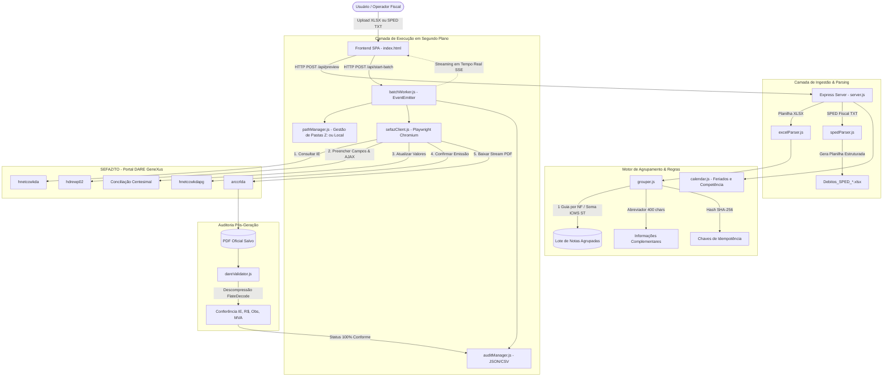
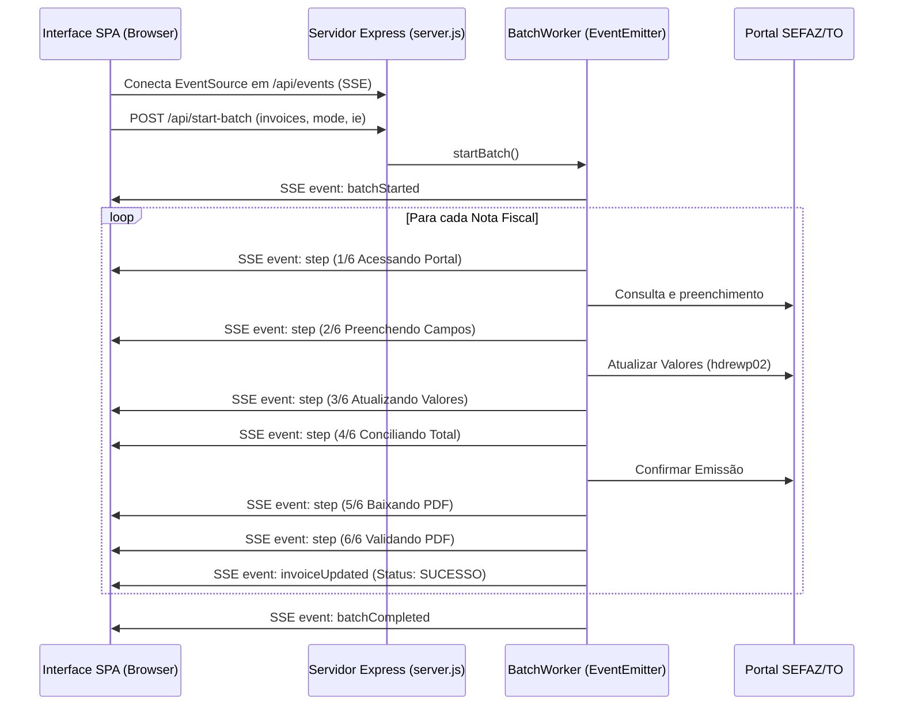

# GeraDARE — Documentação Técnica & Arquitetura de Software
### Relatório Completo para Desenvolvedores e Agentes de IA (Claude, Gemini, Antigravity)

> **Versão do Sistema**: 1.0.0  
> **Repositório Oficial**: [https://github.com/britsu/GeraDARE](https://github.com/britsu/GeraDARE)  
> **Finalidade deste documento**: Servir como especificação técnica exaustiva, mapa de código e guia operacional para que desenvolvedores humanos e agentes autônomos de Inteligência Artificial compreendam 100% da arquitetura, regras fiscais, idiossincrasias do portal SEFAZ/TO (GeneXus) e possam implementar melhorias, refatorações e manutenções com tolerância zero a regressões.

---

## Sumário

1. [Visão Geral e Propósito do Sistema](#1-visão-geral-e-propósito-do-sistema)
2. [Arquitetura Geral e Fluxo de Dados](#2-arquitetura-geral-e-fluxo-de-dados)
3. [Estrutura de Arquivos e Mapa de Componentes](#3-estrutura-de-arquivos-e-mapa-de-componentes)
4. [Tributos e Regimes Fiscais Suportados](#4-tributos-e-regimes-fiscais-suportados)
5. [O Guia Definitivo do Portal SEFAZ/TO e GeneXus](#5-o-guia-definitivo-do-portal-sefazto-e-genexus)
6. [Regras de Negócio e Algoritmos Críticos](#6-regras-de-negócio-e-algoritmos-críticos)
7. [Mecanismos de Idempotência, Diretórios e Persistência](#7-mecanismos-de-idempotência-diretórios-e-persistência)
8. [Auditoria Pós-Geração e Validação de PDFs](#8-auditoria-pós-geração-e-validação-de-pdfs)
9. [Interface do Usuário (Frontend SPA) e Streaming SSE](#9-interface-do-usuário-frontend-spa-e-streaming-sse)
10. [Bateria de Testes Automatizados](#10-bateria-de-testes-automatizados)
11. [Protocolo de Evolução Segura para IAs](#11-protocolo-de-evolução-segura-para-ias)
12. [Guia de Execução e Comandos Úteis](#12-guia-de-execução-e-comandos-úteis)

---

## 1. Visão Geral e Propósito do Sistema

O **GeraDARE** é uma solução completa de automação desktop/web voltada para escritórios de contabilidade e departamentos fiscais que precisam emitir, calcular, conciliar e auditar guias **DARE (Documento de Arrecadação de Receitas Estaduais)** junto ao portal da **Secretaria da Fazenda do Estado do Tocantins (SEFAZ/TO)**.

### Problemas que o Sistema Resolve
1. **Trabalho braçal repetitivo**: A digitação manual de dezenas ou centenas de guias DARE no portal web legado da SEFAZ consome dias de trabalho por período de apuração.
2. **Erros de cálculo e arredondamento**: Falhas no arredondamento centesimal de dezenas de itens de uma mesma nota ou divergências entre valor contábil e ICMS ST.
3. **Limite de 400 caracteres da SEFAZ**: O portal da SEFAZ/TO limita o campo de informações complementares a exatamente 400 caracteres. Quando uma NF possui muitos itens e múltiplos MVAs, o texto estoura o campo e a guia é rejeitada ou truncada incorretamente.
4. **Subcódigo incorreto de ICMS Normal**: No portal da SEFAZ, a receita 110 disponibiliza opções de recolhimento *por Operação* e *por Apuração*. Gerar a guia por Operação acarreta graves inconsistências tributárias para empresas optantes de TARE. O GeraDARE garante a seleção estrita por Apuração.
5. **Rastreabilidade e Não-Interferência**: O aplicativo opera via navegador headless isolado, sem mover o mouse do usuário, registrando auditoria linha a linha em JSON e CSV, e conferindo o PDF emitido contra a planilha original.

---

## 2. Arquitetura Geral e Fluxo de Dados

O sistema é construído sobre o ecossistema **Node.js**, com arquitetura em camadas orientada a eventos (*Event-Driven Architecture*):



---

## 3. Estrutura de Arquivos e Mapa de Componentes

```text
GeraDARE/
│
├── public/
│   ├── favicon.ico                   # Ícone oficial da aplicação
│   └── index.html                    # Frontend SPA completo (Tailwind CSS, FontAwesome, Visual Stepper, ETA)
│
├── src/
│   ├── config.js                     # Dicionário mestre de tributos, códigos, subcódigos, diretórios e portas
│   ├── server.js                     # Servidor HTTP Express, rotas REST e SSE (/api/events)
│   │
│   ├── audit/
│   │   ├── auditManager.js           # Gerenciador de persistência incremental de processamento.json e resultado.csv
│   │   └── dareValidator.js          # Leitor/descompressor de PDFs DARE, validação reversa contra dados originais
│   │
│   ├── engine/
│   │   └── grouper.js                # Agrupador 1 guia/NF, arredondamento centesimal, abreviador determinístico <=400c
│   │
│   ├── parser/
│   │   ├── excelParser.js            # Parser de XLSX, tolerância a cabeçalhos variáveis, MVA e expurgo de totais
│   │   └── spedParser.js             # Parser de SPED EFD (Blocos 0000, E115, E250, E116) e gerador de Excel
│   │
│   ├── portal/
│   │   └── sefazClient.js            # Motor Playwright, manipulação do GeneXus, eventos AJAX e download HTTP
│   │
│   ├── storage/
│   │   └── pathManager.js            # Resolução de diretórios (Z: / fallback local), anti-sobrescrita, nomes oficiais
│   │
│   ├── utils/
│   │   └── calendar.js               # Feriados nacionais e do Tocantins, dias úteis, cálculo de competência fiscal
│   │
│   └── worker/
│       └── batchWorker.js            # Fila sequencial orientada a eventos, pausa, cancelamento e progresso granular
│
├── tests/
│   ├── run_all_tests.js              # Suite monolítica oficial com 63 testes obrigatórios automatizados
│   └── SpedEFD-*.txt                 # Arquivo SPED real higienizado para testes de regressão
│
├── assets/icons/                     # Coleção de identidades visuais e ícones Windows
├── start_app.js                      # Inicializador do runtime Node.js com detecção de porta livre
├── start_geradare.bat                # Script de duplo clique para usuários leigos no Windows
├── package.json                      # Manifesto de dependências do projeto
├── .gitignore                        # Regras de proteção para não subir node_modules, PDFs ou dados sensíveis
└── README.md                         # Este relatório e guia de desenvolvimento
```

---

## 4. Tributos e Regimes Fiscais Suportados

O GeraDARE suporta formalmente cinco códigos de receita estaduais da SEFAZ/TO, operando com regras fiscais distintas para cada um:

| Cód. Receita | Nome do Tributo | Subcódigo no Portal | Tipo de Doc. (`vDRETDCORI`) | Prefixo Oficial do PDF | Origem dos Dados |
|:---:|:---|:---:|:---:|:---|:---|
| **140** | ICMS ST | `2` (Operações Externas) | `Nota Fiscal` (Chave NFe) | `DARE ICMS ST NF` | Planilha XLSX (`ICMS ST.xlsx`) |
| **119** | FECOEP | `5` (Sub III ST Entrada) | `5` (OUTROS A ESPECIFICAR) | `DARE FECOEP NF` | Planilha XLSX (`ICMS ST MATRIZ.xlsx`) |
| **130** | ICMS ST Apuração | `1` (b - Saídas Internas) | `5` (OUTROS A ESPECIFICAR) | `DARE ICMS ST APURACAO` | SPED Fiscal (`Bloco E250`) |
| **643** | FDE | `0` (Sem subcódigo) | `5` (OUTROS A ESPECIFICAR) | `DARE FDE` | SPED Fiscal (`Bloco E115 - TO45/Custeio`) |
| **110** | ICMS Normal | `1` (b- - Por Apuração) | `5` (OUTROS A ESPECIFICAR) | `DARE ICMS NORMAL` | SPED Fiscal (`Bloco E116`) |

---

## 5. O Guia Definitivo do Portal SEFAZ/TO e GeneXus

O portal da SEFAZ/TO (`https://www.sefaz.to.gov.br/dare/servlet/hnetccwkda`) é gerado pela ferramenta **GeneXus**. Compreender o ciclo de vida do GeneXus é indispensável para evitar quebras silenciosas na automação.

### 5.1. O Ciclo de Vida do GeneXus e Requisições AJAX Ocultas
O formulário web do portal não utiliza formulários HTML padrão com submissão simples. Ele se apoia em:
1. **Objeto Global `gx`**: A biblioteca JavaScript client-side gerada pelo GeneXus (`gx.evt.onchange`, `gx.fn.setControlValue`, `gx.O`).
2. **Web Panels e Handlers AJAX**:
   - `hnetccwkda`: O servlet principal que renderiza a casca do DARE.
   - `hdrewp02`: Handler de backend responsável por disparar requisições assíncronas toda vez que `#vDRECDGRCT` (Código da Receita) ou `#vSUBCDGRCT` (Subcódigo) são alterados.
   - `hnetccwkdapg`: Página de pós-confirmação com o botão `#IMGIMPDARE`.
   - `arccrlda`: Servlet de streaming que entrega o arquivo binário do PDF.

> [!CAUTION]
> **A Armadilha do AJAX Descompassado**:
> Se você alterar o código da receita (`#vDRECDGRCT`) e preencher imediatamente os campos de data, valor ou observação sem esperar a resposta do AJAX de `hdrewp02`, o servidor da SEFAZ retornará uma resposta que **limpa e sobrescreve** todos os campos preenchidos de volta para o estado inicial!
> 
> **Regra Obrigatória**: O cliente Playwright deve registrar um `page.waitForResponse(res => res.url().includes('hdrewp02'))` e aguardar sua conclusão antes de prosseguir com o preenchimento dos campos subsequentes.

### 5.2. Mapa Completo de Elementos DOM do Portal

| Seletor / ID | Tipo | Função no Portal |
|:---|:---|:---|
| `#vINSCRICAOESTADUAL` | `<input text>` | Campo onde é digitada a IE sem pontuação |
| `input[name="BUTTON1"]` | `<input button>` | Botão "Consultar" da tela de identificação da empresa |
| `#vDRERAZSOC` | `<input text>` | Razão social retornada pela consulta da SEFAZ |
| `#vDREINSEST` | `<input text>` | Inscrição estadual formatada retornada |
| `#vMUNCDGORI` | `<select>` | Município de origem do contribuinte |
| `#vCECPFCNPJ` / `#span_vCECPFCNPJ` | `<input>` / `<span>` | CNPJ do contribuinte |
| `#vDRECDGRCT` | `<select>` | Código da Receita (140, 119, 130, 643, 110) |
| `#vSUBCDGRCT` | `<select>` | Subcódigo da Receita (populado dinamicamente via AJAX) |
| `#vDRETDCORI` | `<select>` | Tipo do Documento de Origem (`1` = Nota Fiscal, `5` = Outros) |
| `#vDRECDGMUN` | `<select>` | Município da Receita (deve bater estritamente com a Origem) |
| `#vDREDOCORI` | `<input text>` | Número da Nota Fiscal (obrigatório para 140; em branco para 119/643/130/110) |
| `#vDRENFECHV` | `<input text>` | Chave NFe de 44 dígitos (aparece apenas para código 140 com subcódigo 2) |
| `#vDREDTAVEN` | `<input text>` | Data de vencimento no formato `DD/MM/AAAA` |
| `#vDREREFCHAR` | `<input text>` | Período de referência / Competência no formato `MM/AAAA` |
| `#vDREVLRPRI` | `<input text>` | Valor principal da guia (formato brasileiro `1.234,56`) |
| `#vDREINFCOM` | `<textarea>` | Informações complementares (estritamente $\le 400$ caracteres) |
| `input[value="Atualizar Valores"]` | `<input button>` | Dispara o cálculo oficial de acréscimos/juros/multas |
| `#vDREVLRTOT` | `<input text>` / `<span>` | Valor total consolidado retornado pelo backend da SEFAZ |
| `input[name="BTN_ENTER"]` | `<input button>` | Botão "Confirmar" que gera a guia definitiva |
| `#IMGIMPDARE` | `` / `<button>` | Imagem/botão "Imprimir DARE" na página `hnetccwkdapg` |

### 5.3. A Correção Histórica do Subcódigo 110 (ICMS Normal)

> [!IMPORTANT]
> **Bug Crítico Documentado**:
> No portal da SEFAZ/TO, ao selecionar a receita **110 (ICMS NORMAL)**, o campo `#vSUBCDGRCT` contém duas opções:
> - `value: "2"`: `a- - ICMS NORMAL POR OPERAÇÃO`
> - `value: "1"`: `b- - ICMS NORMAL POR APURAÇÃO`
> 
> No código original, a seleção utilizava a busca genérica `o.text.toUpperCase().includes('NORMAL')`. Como a opção `a-` aparece primeiro na lista e contém a palavra `"NORMAL"`, ela era selecionada indevidamente, gerando o DARE por OPERAÇÃO.
> 
> **A Regra Implementada em [`sefazClient.js`](file:///c:/Users/User/Documents/GeraDARE/src/portal/sefazClient.js)**:
> O código agora rejeita expressamente qualquer opção contendo `"OPERAÇÃO"` ou `"OPERACAO"` e seleciona estritamente a opção que casa com `"APURAÇÃO"`, `"APURACAO"`, letra `b-` ou valor numérico `"1"`.

---

## 6. Regras de Negócio e Algoritmos Críticos

### 6.1. Fórmula de Arredondamento Centesimal Duplo (ICMS ST)
A coluna `Valor Contábil` jamais é utilizada como valor da guia. O cálculo do valor da guia para uma nota fiscal segue rigorosamente a especificação fiscal de arredondamento em dois níveis:

$$\text{valor\_item} = \text{round}(\text{ICMS\_ST}_{\text{item}}, 2)$$

$$\text{valor\_guia}(\text{NF}) = \text{round}\left(\sum_{i=1}^{n} \text{valor\_item}_i, 2\right)$$

O motor armazena tanto a soma bruta dos pontos flutuantes (`rawSum`) quanto a soma arredondada (`roundedSum`), registrando no relatório de auditoria qualquer diferença de milésimos decorrente de dizimas.

### 6.2. Motor de Normalização de MVA
O MVA (Margem de Valor Agregado) pode se apresentar de diversas formas em planilhas contábeis. A função `normalizeMVA(val)` em [`excelParser.js`](file:///c:/Users/User/Documents/GeraDARE/src/parser/excelParser.js) atende à seguinte matriz de decisão:
- Se contiver `%` (ex: `'26.50%'`, `'76%'`, `'106,14%'`): extrai o valor numérico diretamente, preservando a escala percentual.
- Se for numérico ou texto sem `%`:
  - Se $\text{valor} < 10.0$ (ex: `0.265`, `0.76`, `0.9969`, `1.0614`): trata-se de razão decimal; multiplica por 100 $\rightarrow$ `26,5%`, `76%`, `99,69%`, `106,14%`.
  - Se $\text{valor} \ge 10.0$ (ex: `26.5`, `76`, `106.14`): já representa o percentual inteiro $\rightarrow$ `26,5%`, `76%`, `106,14%`.

### 6.3. O Algoritmo Abreviador de 4 Passadas ($\le 400$ Chars)
A SEFAZ rejeita observações com mais de 400 caracteres. Para notas fiscais com dezenas de itens diferentes, cortar o final da string eliminaria a chave da NFe ou os MVAs, invalidando a guia. A função `formatObservation()` em [`grouper.js`](file:///c:/Users/User/Documents/GeraDARE/src/engine/grouper.js) executa um funil de compressão determinístico em 4 fases:

1. **Passo 1 (Dicionário Léxico Fiscal)**: Substitui termos comuns por abreviações padronizadas (`FARINHA` $\rightarrow$ `FAR`, `COM FERMENTO` $\rightarrow$ `C/FERM`, `SARDINHA` $\rightarrow$ `SARD`, `QUILOGRAMAS` $\rightarrow$ `KG`, `REFRIGERANTE` $\rightarrow$ `REFRIG`).
2. **Passo 2 (Redução Iterativa dos Itens Mais Longos)**: Caso ainda exceda 400 caracteres, identifica iterativamente os nomes de produtos mais extensos e reduz progressivamente apenas eles, mantendo no mínimo 3 caracteres e preservando intactos o número da NF, MVAs e Chave.
3. **Passo 3 (Consolidação de Cauda)**: Se houver dezenas de produtos distintos e mesmo após o Passo 2 a string estourar, consolida produtos secundários de cada grupo MVA como `"E OUTROS (X ITENS)"`, mantendo o produto principal e o percentual MVA intactos.
4. **Passo 4 (Sufixo Garantido)**: Trava de segurança final que protege os últimos caracteres da observação contendo o sufixo fiscal `NA NF [NUMERO] (MVA X%)`.

---

## 7. Mecanismos de Idempotência, Diretórios e Persistência

### 7.1. Chave de Idempotência Criptográfica
Cada guia possui um hash determinístico SHA-256 gerado por:

$$\text{Hash} = \text{SHA256}(\text{IE}_{\text{dígitos}} \parallel \text{NF}_{\text{normalizada}} \parallel \text{Vencimento}_{\text{DD/MM/AAAA}} \parallel \text{Cód\_Receita} \parallel \text{Valor}_{\text{0.00}})$$

Antes de realizar qualquer requisição à SEFAZ, o método `checkInvoiceIdempotency()` verifica:
1. Se o arquivo PDF correspondente já existe na pasta do cliente;
2. Se o arquivo possui tamanho em disco maior que zero bytes;
3. Se o arquivo `processamento.json` contém registro com status `SUCESSO` ou `BAIXADA` com o mesmo hash.

Sendo atendidas essas condições, o processamento da nota é ignorado com status `JA_PROCESSADA`, economizando tempo e evitando recolhimento em duplicidade.

### 7.2. Estrutura de Diretórios e Prioridade da Competência
A estrutura raiz segue o padrão corporativo:

```text
Z:\DOCUMENTOS TEMPORÁRIOS\LUIS HENRICK\DARE\MM-AAAA\NOME_DA_EMPRESA [- FILIAL CNPJ ...]
```

- **Fallback Local**: Se o drive de rede `Z:` não estiver montado ou for inacessível, o sistema recorre automaticamente a `GeraDARE/output/DARE/MM-AAAA/...`.
- **Mês da Competência vs Vencimento**: A pasta mensal `MM-AAAA` é estritamente resolvida a partir do mês da competência fiscal (ex: competência `08/2026` gera pasta `08-2026`, mesmo que o vencimento seja em `09/09/2026`).
- **Não-Sobrescrita Atômica**: Se a pasta da empresa já contiver um lote finalizado, o sistema cria automaticamente pastas sequenciais: `NOME (1)`, `NOME (2)`, etc.
- **Detecção de Filial**: CNPJs cujo radical não termine em `0001` recebem sufixo automático no diretório com o número limpo do CNPJ.

---

## 8. Auditoria Pós-Geração e Validação de PDFs

Diferente de sistemas que apenas baixam arquivos, o GeraDARE implementa um pipeline reverso de auditoria em [`dareValidator.js`](file:///c:/Users/User/Documents/GeraDARE/src/audit/dareValidator.js).

### Como Funciona a Descompressão Binária
1. O PDF gerado pela SEFAZ utiliza compressão `FlateDecode` (Zlib/Deflate) sobre os streams de texto (`stream ... endstream`).
2. O validador localiza cada stream binário, descomprime via `zlib.inflateSync()` e aplica expressões regulares sobre os operadores PostScript `Tj` e `TJ`.
3. Trata escapes de parênteses literais `\(` e `\)` comuns em PDFs contábeis.
4. **Conferência em 3 Eixos**:
   - **Eixo 1 (IE)**: Confere se a IE gravada no PDF bate com a IE da empresa.
   - **Eixo 2 (Valor)**: Confere se o valor principal ou total do PDF bate com precisão centesimal ($\pm 0,05$) com a planilha.
   - **Eixo 3 (Observação e Subcódigo)**: Confere se a NF e todos os MVAs estão expressos no documento. Para ICMS Normal (110), **rejeita imediatamente** o PDF se constar `"POR OPERAÇÃO"`.

---

## 9. Interface do Usuário (Frontend SPA) e Streaming SSE

A interface web ([`public/index.html`](file:///c:/Users/User/Documents/GeraDARE/public/index.html)) opera como uma aplicação moderna de página única sem frameworks pesados, garantindo carregamento instantâneo.



### Principais Recursos da Interface:
- **Visual Stepper de 6 Etapas**: Cartões animados que mostram o micro-progresso de cada nota individualmente.
- **Motor de ETA com Aprendizado Histórico (EMA)**: Calcula o tempo restante ponderando 65% do ritmo do lote atual e 35% do histórico empírico salvo no `localStorage`.
- **Filtros Dinâmicos por Empresa**: Pílulas de filtro para alternar visualização entre Matriz e Filiais em planilhas consolidadas.
- **Botões Globais "Limpar Tudo / Nova Geração" (`resetAllState()`)**:
  - Presentes no Cabeçalho fixo, no Card 1 e na Barra de Execução.
  - Cancelam processos em andamento com confirmação de segurança.
  - Resetam dropzone, valores, campos de texto, filtros, tabelas e memória de execução de forma limpa.

---

## 10. Bateria de Testes Automatizados

O projeto mantém **63 testes unitários e de integração obrigatórios**, executados via:

```bash
npm test
```

### Cobertura dos Testes ([`run_all_tests.js`](file:///c:/Users/User/Documents/GeraDARE/tests/run_all_tests.js)):
1. **Importador XLSX**: Expurgo de linhas `TOTAIS`, normalização de MVAs decimais e percentuais, leitura monetária brasileira.
2. **Agrupamento e Valores**: Agrupamento por nota, isolamento de grupos MVA (ex: NF 25105 com trigo 76% e sardinha 65%), descarte de valor contábil.
3. **Calendário Fiscal**: Dias úteis, feriados do Tocantins (05/10 Criação do Estado, Padroeira), cálculo de competência.
4. **Diretórios e Idempotência**: Prioridade do mês da competência, sanitização Windows, hash determinístico SHA-256.
5. **Abreviador 400 Chars**: Integridade de MVAs múltiplos e garantia matemática de comprimento $\le 400$.
6. **Auditoria de PDFs**: Descompressão de stream, unescape de caracteres PostScript, validação reversa de IE e valor.
7. **Suporte a FECOEP (119)**: Filtro de notas com FECOEP > 0, inclusão da Chave NFe na observação, nomenclatura oficial.
8. **Endpoints Express e Worker**: Testes de API para `/api/preview`, `/api/open-folder`, `/api/validate-batch`, download de PDF e SSE.
9. **SPED Fiscal**: Extração de blocos 0000, E115 (FDE), E250 (ST Apuração) e E116 (ICMS Normal).
10. **Subcódigo ICMS Normal**: Validação de que a seleção para o código 110 escolhe exclusivamente **Apuração (subcódigo 1)** e bloqueia **Operação (subcódigo 2)**.
11. **Interface e Reset**: Conferência da presença e integridade da função `resetAllState()` e seus respectivos seletores de tela.

---

## 11. Protocolo de Evolução Segura para IAs

Se você é um modelo de linguagem ou agente autônomo (Claude, Gemini, etc.) encarregado de modificar este código, siga rigorosamente este checklist:

1. **Preserve a Não-Interferência**: Nunca introduza bibliotecas que controlem o cursor do mouse real ou usem atalhos de teclado globais no Windows.
2. **Respeite o Arredondamento Centesimal**: Nunca altere a regra de arredondamento por item antes da soma final. Arredondar somente a soma total causa divergência centesimal com o portal da SEFAZ.
3. **Atenção ao Subcódigo 110**: Nunca altere a lógica de subcódigo em [`sefazClient.js`](file:///c:/Users/User/Documents/GeraDARE/src/portal/sefazClient.js) para aceitar termos genéricos como `"NORMAL"`. Deve ser sempre `APURAÇÃO` (subcódigo `1`).
4. **Proteja a Nomenclatura de Arquivos**: Os padrões de nomes de PDF são auditados por clientes e escritórios parceiros. Qualquer alteração em `getStandardPdfName` quebrará a idempotência de guias existentes.
5. **Sempre Execute a Bateria de Testes**: Antes de concluir qualquer tarefa, execute `npm test` e certifique-se de que os 63 testes passem com 100% de sucesso.
6. **Mantenha este README Atualizado**: Qualquer novo endpoint, tributo ou regra fiscal deve ser refletido imediatamente neste documento.

---

## 12. Guia de Execução e Comandos Úteis

### Iniciar o Aplicativo em Modo Desktop
```bash
# Via script Windows (duplo clique)
start_geradare.bat

# Ou via terminal
npm start
```
Acesse no navegador: **[http://localhost:3456](http://localhost:3456)**

### Executar os Testes Automatizados
```bash
npm test
```

### Sincronização com o GitHub
```bash
git status
git add .
git commit -m "docs/feat: atualizacoes no geradare"
git push origin main
```
